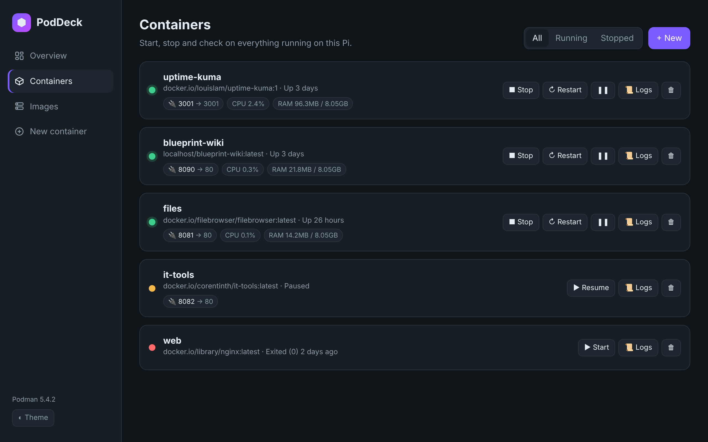
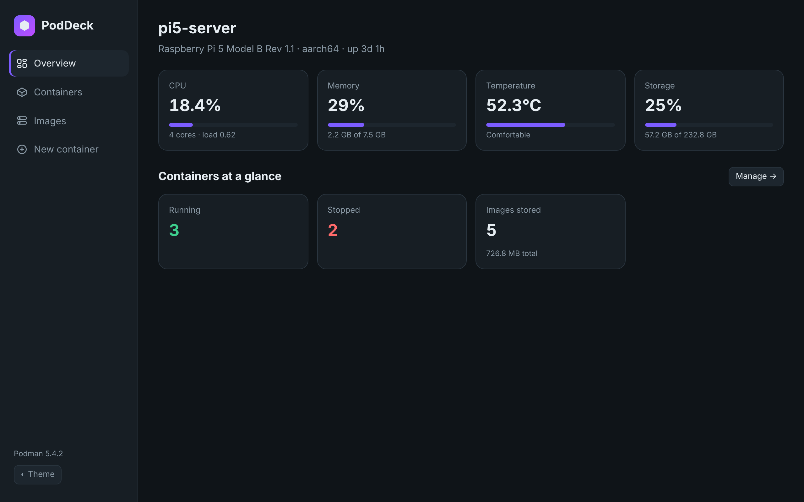
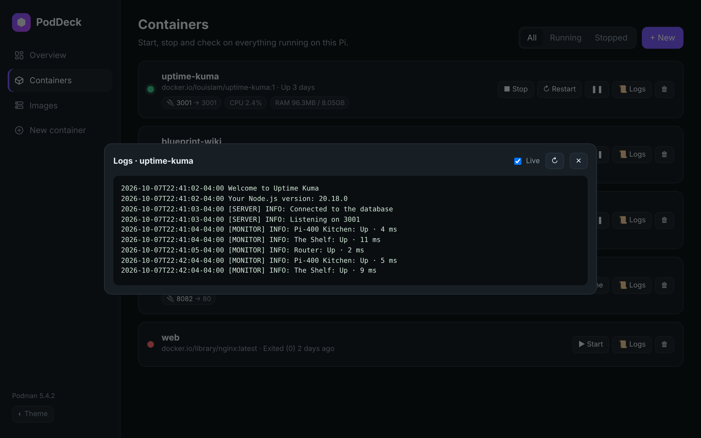
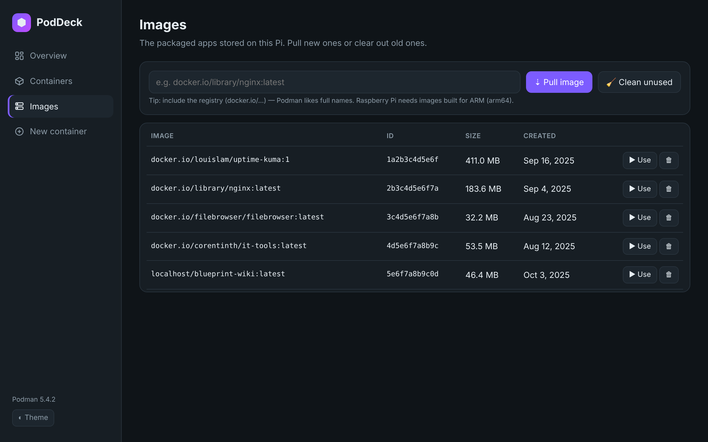
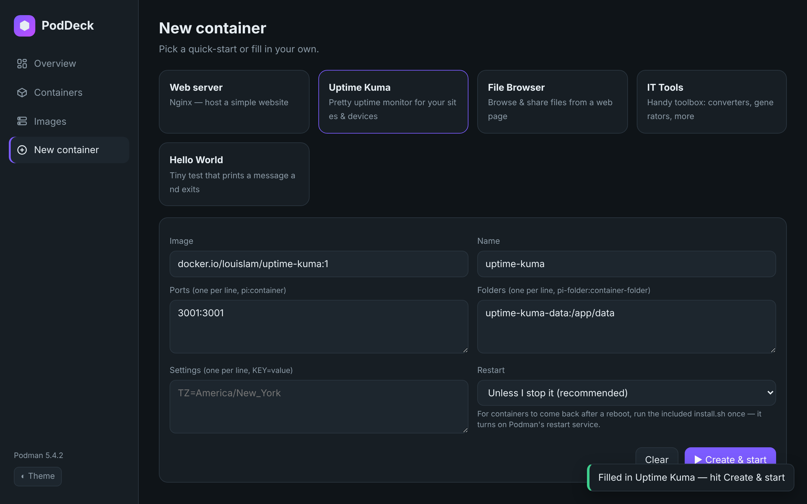
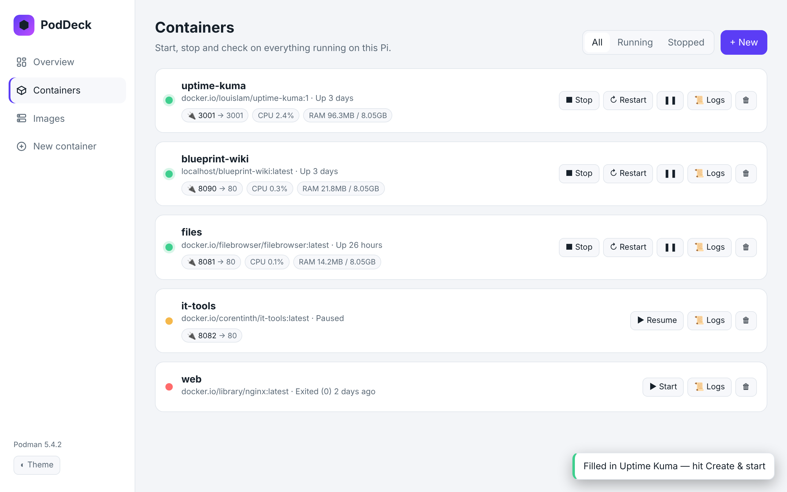
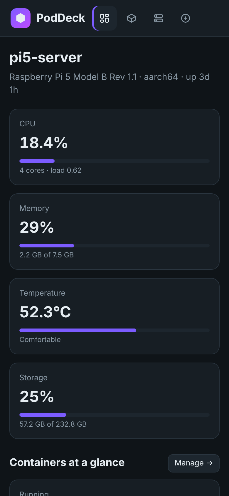

# ⬢ PodDeck

A friendly web dashboard for Podman, built for Raspberry Pi. Open it in any browser — on the Pi, your laptop or your phone.



| Overview | Live logs |
|---|---|
|  |  |
| **Images** | **New container** |
|  |  |
| **Light theme** | **On your phone** |
|  |  |

## What it does

- **Overview** – your Pi's CPU, memory, temperature and storage, plus how many containers are running
- **Containers** – start, stop, restart, pause or remove them, see live CPU/RAM per container, click a port to open the app, and watch logs live
- **Images** – pull new images, delete old ones, one-click clean-up of unused ones
- **New container** – a simple form (image, name, ports, folders, settings, restart rule) plus quick-starts: Nginx web server, Uptime Kuma, File Browser, IT Tools and a Hello World test

No extra Python packages, no internet needed for the dashboard itself — just Python 3 (already on Raspberry Pi OS) and Podman.

## Install (recommended)

Copy the `poddeck` folder to the Pi, then in a terminal:

```bash
cd poddeck
bash install.sh
```

It installs Podman if missing, asks you to pick a password, sets PodDeck to start on every boot, and puts a **PodDeck** shortcut on the Desktop.

Then open **http://localhost:8070** on the Pi, or **http://&lt;pi-ip&gt;:8070** from another device.

## Just try it (no install)

```bash
python3 poddeck.py
```

Press Ctrl+C to stop. Add a password with `PODDECK_PASSWORD=mypassword python3 poddeck.py`.

## Settings

| Variable | Default | What it does |
|---|---|---|
| `PODDECK_PORT` | `8070` | Web port |
| `PODDECK_HOST` | `0.0.0.0` | Use `127.0.0.1` to allow only the Pi itself |
| `PODDECK_PASSWORD` | *(none)* | Require a sign-in |

## Good to know

- PodDeck runs **rootless** as your normal user, so it manages *your* containers (the same ones `podman ps` shows without sudo).
- Images must be built for **ARM64** to run on a Pi. The quick-starts all are.
- Rootless containers can't use ports below 1024 — use 8080 instead of 80, and so on.
- Anyone who can open PodDeck can run containers on your Pi, so set a password if it's on a shared network.
- Removing PodDeck (`bash uninstall.sh`) never deletes your containers or images.
